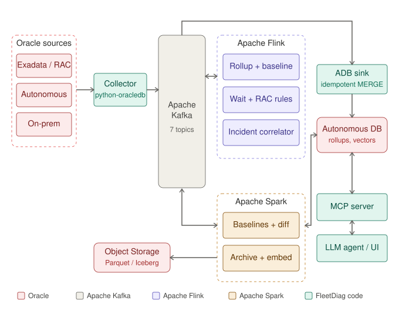
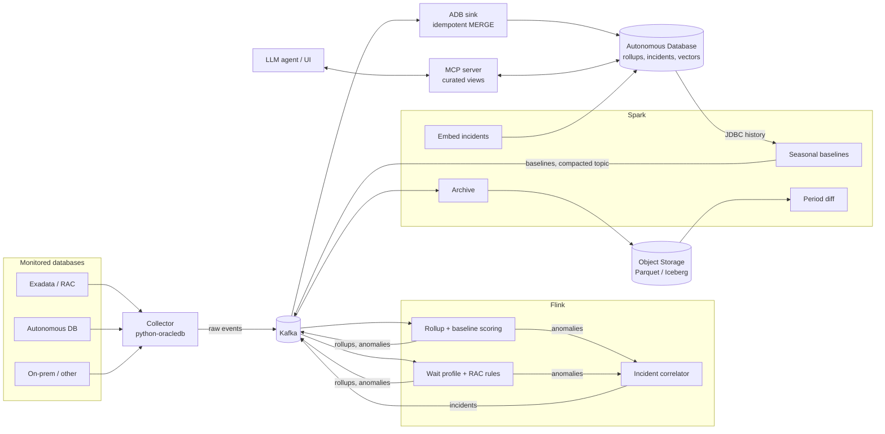

# Architecture

## Goals

- One view across the whole fleet, with a baseline per database, instance, metric and hour of week.
- Detection in minutes, not at the next AWR report.
- Oracle-aware rules, starting with RAC global cache behavior.
- Explanations grounded in stored evidence and in similar past incidents.
- Autonomous Database is the store and serving layer, but the monitored databases can be any Oracle database the collector can reach.

Non-goals for v1: replacing Cloud Control, automatic remediation, tuning advice, non-Oracle sources.

## Overview

The same flow as editable Mermaid source:

## Kafka topics

| Topic | Producer | Consumer | Key | Notes |
|---|---|---|---|---|
| `ora.metric.raw.v1` | collector | Flink, Spark archive | `db_id/inst_id` | 60 s system metrics |
| `ora.ash.raw.v1` | collector | Flink, Spark archive | `db_id/inst_id` | ASH rows, diag-pack mode only |
| `ora.metric.rollup.v1` | Flink | sink | `db_id/inst_id/metric` | 1 and 5 minute buckets |
| `ora.wait.rollup.v1` | Flink | sink | `db_id/inst_id` | AAS by wait class and event |
| `ora.anomaly.v1` | Flink | sink, correlator | `db_id` | deterministic `anomaly_key` |
| `ora.incident.v1` | Flink | sink, agent | `db_id` | deterministic `incident_key`, upserts |
| `ora.baseline.v1` | Spark | Flink (broadcast state) | `db_id/inst_id/metric` | compacted, one message per series |

Delivery is at-least-once everywhere. Idempotence comes from deterministic keys and MERGE in the sink.

## Components

### Collector (`collector/`)
- Python, python-oracledb in thin mode, one process per fleet segment.
- Connects with a monitoring user that has SELECT on named views only.
- System metrics every 60 s. ASH deltas every 5 to 15 s using a per-instance watermark, so restarts neither skip nor duplicate rows.
- The SQL it runs lives in `collector/queries/` so a DBA can read exactly what touches production.
- Two modes: `base` (no ASH/AWR) and `diag-pack` (ASH/AWR, requires the Diagnostics Pack license). Check the view list against the Licensing Information guide for each release you support.

### Flink jobs (`flink-jobs/`, Java DataStream API)
1. **rollup**: raw samples to 1 and 5 minute buckets per db, instance and metric.
2. **baseline-scoring**: score against the seasonal baseline held in broadcast state. EWMA fallback until a baseline exists.
3. **wait-profile**: per-minute average active sessions by wait class and event, top SQL IDs, blocker chains.
4. **rac-rules**: global cache latency vs baseline, Cluster wait class share of DB time, per-instance skew, surges in `gc buffer busy acquire`, `gc cr block busy` and similar events.
5. **incident-correlator**: session window per database (5 minute gap). Opens an incident on two or more correlated anomalies or one critical, closes after 15 minutes of quiet.

Flink never writes to ADB directly. It writes to Kafka and checkpoints to object storage.

### ADB sink (`sink/`)
Small service that reads the rollup, anomaly and incident topics and applies batched MERGE statements (python-oracledb `executemany`). It keeps the wallet and connection handling in one place and avoids depending on a Flink Oracle JDBC dialect. A direct Flink JDBC sink is the alternative (DECISIONS D2).

### Spark jobs (`spark-jobs/`, PySpark)
1. **baselines**: read several weeks of rollups, compute median and MAD per series and hour of week, publish to `ora.baseline.v1` and upsert `fd_baseline`.
2. **period-diff**: compare two periods across the fleet: load profile, top wait events, top changed SQL.
3. **archive**: raw topics to Parquet/Iceberg on object storage for long retention.
4. **embed**: summarize and embed closed incidents and runbook chunks into the VECTOR columns.

### Autonomous Database (`sql/`)
- Tables in `001_schema.sql`: inventory, rollups (interval-partitioned by day), wait profile, baselines, anomalies, incidents, runbook chunks.
- Views in `002_views.sql` are the only surface exposed to Select AI and to the MCP server.
- Similar-incident search is hybrid: vector distance plus relational filters (same platform, same major version, RAC or not).

### MCP server and agent (`mcp-server/`)
Tools: `list_incidents`, `get_incident_evidence`, `get_metric_series`, `compare_periods`, `find_similar_incidents`, `search_runbooks`, and one narrow write tool, `save_hypothesis`, which runs under a separate account that can update only the hypothesis columns. A DBA confirming or correcting a root cause writes `confirmed_root_cause`, and the embed job turns that into searchable knowledge. During development, the existing Node.js ADB MCP proxy can be used to exercise the views from Claude Desktop.

## Detection

Statistics decide, the LLM explains. That keeps detection cheap, testable and explainable.

- Baseline per series and hour of week (168 slots): median and MAD over the last 4 to 8 weeks.
- Score: `z = |x - median| / max(1.4826 * MAD, floor)`, where `floor` is a per-metric minimum (for example 5% of the median) so flat metrics don't produce infinite scores.
- Fire when `z >= 4` in at least 3 of the last 5 one-minute buckets. These are starting values to tune against real data.
- Ground truth for RAC rules: use DBStress to create known global cache contention and assert that the rules fire and name the right event and instances.

## Sizing (illustrative)

Assumptions: 3,500 databases, 1.5 instances each on average, 30 curated metrics per instance. That is 157,500 series.

- Raw ingest at one value per series per minute: about 2,600 events/s.
- 1 minute rollups in ADB: about 227 million rows/day. Too many to keep routinely.
- 5 minute rollups in ADB: about 45 million rows/day.

Plan: keep 5 minute rollups in ADB (90 days), 1 hour rollups for 2 years, raw and 1 minute data in Kafka (7 days) and the lake. Flink additionally emits 1 minute detail for a window around each anomaly, so incident views have full resolution without storing it everywhere. Measure real compression before fixing these numbers.

## Security and compliance

- Monitoring account: SELECT on a named list of views, not `SELECT ANY DICTIONARY`.
- SQL text can contain literals and personal data. Ship `SQL_ID` and normalized text, and strip or hash literals at the collector.
- ADB access over TLS or mTLS. Secrets come from a vault or secret store, not from files in images.
- For fleets whose data can't leave the customer, run the agent against a private model endpoint. MCP tools return IDs and aggregates by default.
- Multi-tenant visibility by fleet (VPD or Deep Data Security) is planned for M4.

## Integration facts and open checks

Checked against Oracle documentation in October 2026:
- GoldenGate can capture from Autonomous Database and publish JSON to Kafka-compatible topics (OCI Streaming with Apache Kafka). Extract captures only from its own tenant, downstream integrated extract is not supported, and the GGADMIN user is locked by default. This design doesn't need it because the collector pulls, but it matters if you later want transaction-level CDC from application databases.
- OKafka lets Kafka Java clients use TxEventQ instead of a broker (Oracle Database 21c or later). Whether it is available in Autonomous Database was not confirmed. See DECISIONS D1.
- Autonomous AI Lakehouse queries Apache Iceberg tables in place. The product page cites Spark integration but doesn't say whether Iceberg tables can be written or whether a REST catalog is offered. The archive job's write path (D6) depends on this.
- Select AI Agent, MCP server support and True Cache were listed as planned in the 26ai announcement. Confirm current availability before relying on them.
- Flink CDC 3.6.0 (released 2026-03-30, for Flink 1.20.x and 2.2.x) added an Oracle source pipeline connector and SCN-based startup for the Oracle CDC source. It reads changes from Oracle and is not a sink. Its setup requirements (LogMiner or XStream, privileges, supplemental logging) were not verified, and whether it works against Autonomous Database is untested. It is not on the monitoring path, which pulls V$ views; it matters for migration sync (idea 2) and application change streams.
- Not confirmed: a managed Flink service on OCI and the Flink JDBC connector's Oracle dialect. The design avoids both by default.

Sources:
- https://www.oracle.com/adw
- https://www.oracle.com/news/announcement/ai-world-database-26ai-powers-the-ai-for-data-revolution-2025-10-14/
- https://blogs.oracle.com/database/post/oracle-txeventq-and-apache-kafka-integration-two-powerful-paths-to-modern-event-streaming
- https://blogs.oracle.com/dataintegration/realtime-data-replication-from-oracle-ai-database-26ai-to-oci-streaming-with-apache-kafka-using-oci-goldengate
- https://docs.oracle.com/en/middleware/goldengate/core/19.1/ggcab/configure-autonomous-database-capture-replication.html
- https://flink.apache.org/2026/03/30/apache-flink-cdc-3.6.0-release-announcement/
